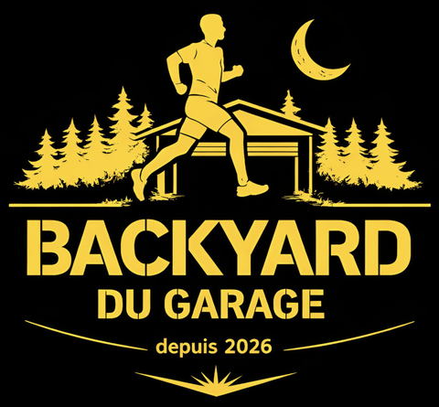
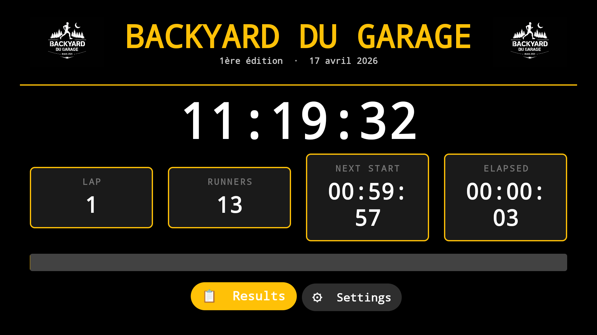
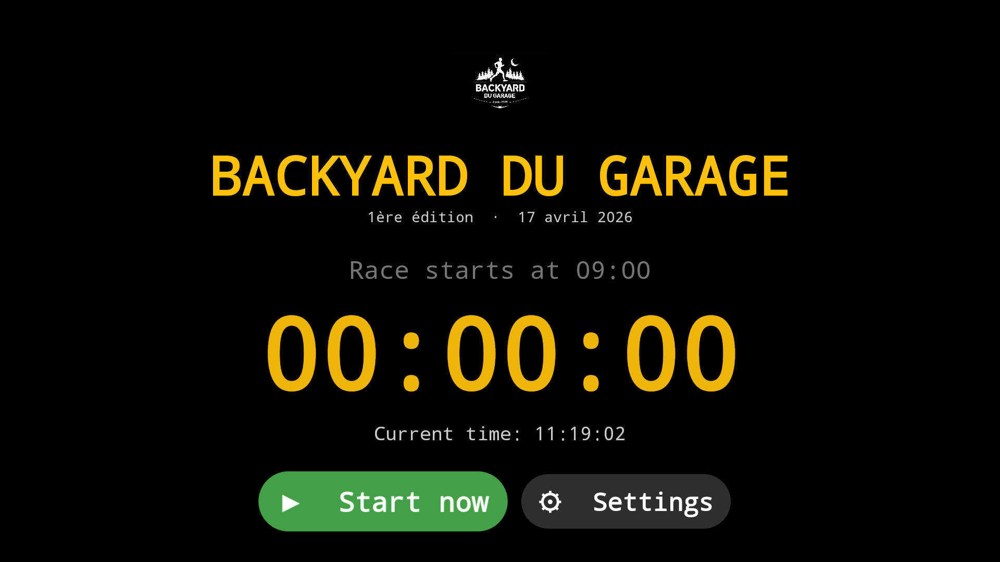
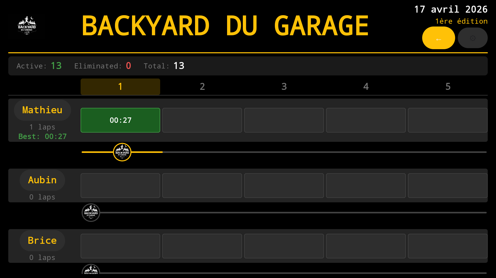
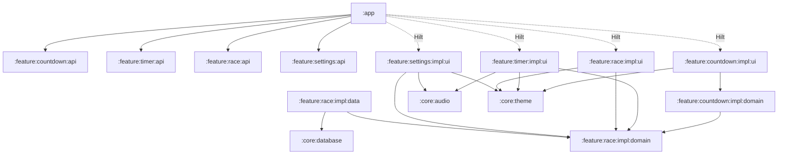

<div align="center">



# Backyard Manager

**Run a Backyard Ultra from your living-room TV.**
A big-screen race clock, live lap grid and podium for [Backyard Ultra](https://en.wikipedia.org/wiki/Backyard_ultra) events, built with Jetpack Compose for Android TV.


<!-- TODO: replace with a short GIF of a lap change (a GIF in the first screen of a README is the #1 driver of stars) -->


</div>

---

## 🏃 What is a Backyard Ultra?

Every hour, on the hour, runners start a **6.706 km loop**. Finish it before the next hour and you may start again. Miss the cutoff and you're out. The last runner standing — who must complete one more loop **alone** — wins. Races routinely go past 24 h (the world record is over 100 hours).

That format needs an organiser that **never blinks**: an exact hourly clock, who's still in, who has clocked in this lap, and a loud warning before the next start. Backyard Manager turns any Android TV into that organiser.

> Born for the *Backyard du Garage* — a race between friends, 1st edition on 17 April 2026 — and battle-tested on race day.

## ✨ Features

| | |
|---|---|
| ⏱️ **Countdown** | Big countdown to the scheduled start, auto-starts at the exact time (or start manually). |
| 🕐 **Race clock** | Time to next start, current lap, runners still in, total elapsed time. Progress bar turns red in the last 30 s, the screen flashes on every new lap. |
| 🔊 **Audio cues** | Start horn each hour, beeps 30 s before the cutoff, *The Final Countdown* in the last seconds, random voice lines at 10 / 7 / 4 minutes — never twice in the same race. |
| 📋 **Live lap grid** | Press a runner's name with the remote to clock their lap. Colour-coded cells (done / DNF / eliminated), current lap highlighted, best lap per runner, and an animated "life line" where each runner's photo runs along the track. |
| 🤖 **Automatic eliminations** | Anyone who hasn't clocked in when the hour strikes is marked DNF — even laps that ended while the app was closed are caught up on restart. |
| 🏆 **Last runner standing** | Detects the solo "assist" lap and declares the winner only once it's completed, per the official rules. |
| 🥇 **Podium** | Final ranking with laps and distance covered, with confetti. |
| ⚙️ **Settings** | Start time, add/remove runners, safe double-press for destructive actions. |
| 💾 **Crash-proof** | Everything is persisted in Room: unplug the TV mid-race, plug it back, carry on. |

## 📸 Screenshots

| Countdown | Race clock | Live results |
|-----------|-----------|--------------|
|  |  |  |

## 🏗️ Architecture

A small app, but structured like a production one — handy if you're looking for a **real-world Compose for TV / multi-module example**.

- **Feature modules split into `api` / `impl`** — the app module only knows the navigation contracts; implementations are bound with Hilt.
- **Clean layering** in each feature: `ui` (Compose + ViewModel + StateFlow) → `domain` (use cases, repository interfaces) → `data` (Room).
- **TV-first UI**: D-pad focus handling, `tv-material3` components, readable from across the room.
- **Performance-minded Compose**: animations read in the draw phase (`graphicsLayer`, `drawBehind`), state derived once per lap rather than once per second.



| Layer | Tech |
|-------|------|
| UI | Jetpack Compose · AndroidX TV Material 3 |
| State | ViewModel · Kotlin Flow / StateFlow |
| DI | Hilt |
| Persistence | Room |
| Navigation | Navigation Compose |
| Audio | MediaPlayer · ToneGenerator |

## 🚀 Getting started

**Requirements:** Android Studio (latest stable), **JDK 17 or 21** (Gradle 8.13 does not run on JDK 25), an Android TV device or emulator.

```bash
git clone https://github.com/athimue/BackyardManager.git
cd BackyardManager
./gradlew assembleDebug
```

### Install on an Android TV over Wi-Fi

1. On the TV: **Settings → Device Preferences → About** → press **Build** 7 times to unlock developer options.
2. Enable **Developer options → USB / network debugging** and note the TV's IP address.
3. From your computer:

```bash
adb connect <TV_IP_ADDRESS>
adb install -r app/build/outputs/apk/debug/app-debug.apk
```

The app shows up in the TV launcher.

> 💡 **Testing tip:** set `LAP_DURATION_SECONDS = 150` in `core/theme/.../Constants.kt` to get 2 min 30 laps and see a whole race in minutes.

## 🗺️ Roadmap

Ideas and contributions welcome — these make great first issues:

- [ ] Event name / date / edition configurable from Settings
- [ ] Configurable lap duration (test mode) from Settings
- [ ] CSV export & share of the results
- [ ] Per-runner stats screen (average lap, consistency chart)
- [ ] Custom runner photos picked from the device
- [ ] English / French localisation via `strings.xml`

## 🤝 Contributing

Issues and pull requests are welcome! If you organise a backyard with this app, I'd love to hear about it — open an issue with a photo of your setup.

If this project is useful or fun to you, **a ⭐ on the repo really helps** others find it.
